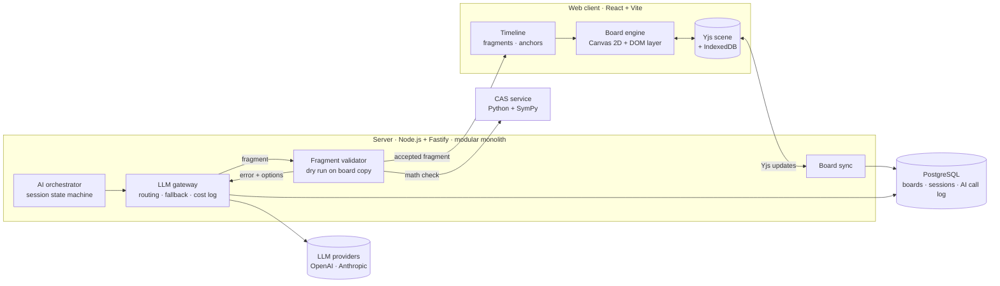

# Mimicria

**An AI tutor that teaches on an infinite whiteboard the way a good teacher does: it writes, draws and points at exactly the right spot while it explains. Underneath is an AI-native board engine built from scratch, where the AI reads the board as data and works through the same API as people.**

🏗️ [Architecture](#architecture) · 🧩 [Board API](#the-board-underneath) · 📩 [Contact](#contact)

> This repository is a showcase. Mimicria is my own commercial product and its source code is private. Code walkthroughs are available on request.

---

## The problem

AI chat is a poor teacher for anything visual or step-by-step. Algebra, physics, chemistry and code are explained on a board: a teacher writes a line, underlines the term they are talking about, draws an arrow, and moves on only when it clicks. A chatbot gives you a wall of text instead — and it can produce a confident step that does not follow from the previous one.

Whiteboards don't solve it either. They treat AI as an add-on: a side panel that drops a sticky note or a picture somewhere on the canvas. The AI doesn't know what is already on the board, piles objects on top of each other and draws geometry that is subtly wrong.

## The AI tutor

1. The learner picks a topic. The tutor plans the lesson.
2. The tutor **writes, draws diagrams and moves the camera** on the board — step by step, not all at once.
3. The explanation and the board run on **one timeline**: the exact term or part of a diagram lights up at the moment the sentence mentions it.
4. The tutor gives an exercise, **watches it being solved on the board**, checks the answer with code and gives hints from a ladder (gentle → specific).
5. If an explanation doesn't land, it is repeated — and then **re-explained in a different format**, adapted to the learner's level and preferred amount of detail.

## The board underneath

The tutor works because the board was designed for an AI participant from day one:

1. **The board is data, not pixels.** Every object has a type, a name and semantics (a LaTeX formula, a diagram description), so the AI reads the board as structured text and can refer to `eq1` or a named part of a diagram.
2. **One Board API for people and AI.** The toolbar, the console and the model send the same commands on three levels — geometry (`shape.create`, `stroke.add`), layout (`write`, `draw`, `connect`, `highlight`, `camera.focus`) and domain (`diagram.plot`, `math.steps`) — so undo, sync and validation work for everyone.
3. **The AI says *where*, code decides *how*.** Content is placed relative to other objects (*below eq1*, *in the work zone*); a layout engine computes coordinates and guarantees nothing overlaps.
4. **The AI describes, code draws.** Diagrams are declarative specs — trees, plots, flowcharts, circuits, chemical reactions — and geometry is computed, not hallucinated.
5. **The AI never touches people's work.** It edits only its own objects and proposes drafts next to a person's work that can be accepted or rejected.

Interface and explanations in **English, Ukrainian and Polish**, including language-specific math notation.

---

## Key features

- **Board engine written from scratch** — Canvas 2D with a DOM layer for editable text and formulas, vector KaTeX formulas, spatial index, smooth camera and animations
- **Layout engine** — zones, relative placement, alignment on `=` signs, no overlaps and no moving of existing content
- **Declarative diagrams** — a registry of diagram families (trees, plots, flowcharts, sketches, law triangles); a new family is added without touching the core
- **Synchronised explanation** — text fragments with anchors drive highlights, reveals, morphs and camera moves
- **Real-time collaboration** — host and viewers, presence and cursors, built on Yjs; load-tested with many simultaneous users
- **AI drafts, people decide** — the AI never edits a person's work; it proposes drafts next to it that can be accepted or rejected
- **Verified content** — every math step is checked for equivalence before it is shown (numeric checker + SymPy CAS service)
- **Domain plugins** — math, code (own Python-subset interpreter with step-by-step trace), chemistry (formula parsing, reaction balancing), electronics (circuit solver with live currents and voltages)
- **Handwriting and voice** — handwritten input recognition, spoken explanation synced to the timeline

---

## Architecture

### How one AI turn works

1. The orchestrator takes a **text snapshot of the board** (objects are data with names and semantics, not pixels) and builds the request.
2. The model returns each explanation fragment as a **tool call**: text with anchors plus board commands.
3. The server **dry-runs the fragment on a copy of the board** and runs nine checks in order: schema, anchors, references, ownership of objects, layout, math equivalence, length, language, and text-vs-board consistency.
4. If a check fails, the model gets a specific error with valid options (`object "eq7" does not exist. Available: eq1, eq2, eq3`) and one chance to fix it; otherwise a safe fallback is used.
5. The accepted fragment goes to the client, which applies it with hidden objects and **reveals them on the timeline**. "Explain again" replays it without calling the model.

### Design decisions

| Decision | Why |
|---|---|
| **The board is data, not a picture** | Every object has a type, a name and semantics (LaTeX, diagram description). The model reads the board as text and can refer to `eq1` or a named part of a diagram. |
| **One path for every change** | Toolbar, console and AI all send the same Board API commands. Nothing writes to the scene directly, so undo, sync and validation work everywhere. |
| **The AI never computes coordinates** | It says *below eq1* or *in the work zone*; a layout engine computes positions and guarantees nothing overlaps. Models are bad at geometry, code isn't. |
| **The AI describes, code draws** | Diagrams are declarative specs; geometry is computed. No hallucinated shapes. |
| **The AI session is a state machine in code** | The model writes the content of a step; the order of steps and transitions are deterministic. |
| **Anything computable is checked by code** | Math correctness is decided by a CAS, not by the model. Examples the AI writes are verified before they are shown. |
| **Commit first, reveal later** | Board commands are applied immediately but hidden until their anchor, so the scene is always consistent for saving, sync and replay. |
| **Multi-provider LLM gateway** | Task → list of models (primary + fallbacks). Every call is logged with tokens, cost and latency. Provider switch happens on timeout without the user noticing. |
| **Record / replay of model responses** | Evaluations and scenarios run in CI without API keys, deterministically. |
| **The AI never touches people's work** | It can only edit its own objects; on a person's work it may add marks on top or propose a draft. |
| **Board content is data, not instructions** | User materials and text from the board are passed in labelled blocks; the AI's tools cannot leave the board. |
| **Enforced package boundaries** | A custom ESLint rule and a CI check enforce who may depend on whom; pure packages compile without DOM or Node types. Third-party libraries live only behind adapters. |

---

## Quality and operations

- **260+ test files**; CI runs types, package boundaries, lint, formatting, tests against PostgreSQL, and the build on every push
- **Browser checks** in real Chromium (Playwright): formula rendering, culling, performance, persistence
- **Golden evaluation set** — 60 topics across 12 subject areas, with the expected *meaning* of each explanation, not a template; a probe runs a full AI session on a real model and collects display metrics
- **Model bake-off tooling** — choosing a model per task by quality, cost and latency; after the last bake-off, the cost of a full AI session dropped from about **$0.031 to about $0.006**
- **Load testing** of the shared board: many users drawing at once, delivery latency, state convergence
- **Security audit** of web and sync: CSP, CSRF, access revocation on live connections, size limits
- **Production setup** — Docker Compose, PostgreSQL with least-privilege roles (the app cannot change the schema), migrations as SQL files, backups with an automated restore check, data retention jobs
- **Launch readiness** — consent and age handling, AI-content labelling, legal texts in Polish, Ukrainian and English, owner dashboard with Telegram alerts

---

## Tech stack

**Frontend:** TypeScript (strict) · React · Vite · Zustand · Canvas 2D · KaTeX · MathLive · perfect-freehand · rbush
**Realtime:** Yjs · y-indexeddb · WebSockets
**Backend:** Node.js · Fastify · Kysely · PostgreSQL · zod
**AI:** multi-provider gateway (OpenAI, Anthropic) · tool calling · structured output · Python + SymPy CAS
**Tooling:** pnpm monorepo · Vitest · Playwright · ESLint · GitHub Actions · Docker

## Status

Board engine, AI runtime, domain plugins, shared board and quality tooling are built. Preparing for public launch: payments and final legal review are in progress.

---

## My role

Mimicria is my own product — from the idea to the architecture:

- came up with the product and defined its non-negotiable principles
- designed the system architecture and wrote the architecture decision records
- designed the board engine, the Board API and the AI runtime: turn, fragment validation, timeline, failure handling
- chose models per task through measured bake-offs and own the cost budget
- set up the engineering process: specification-driven development with AI coding agents, task and report templates, package boundaries and checks enforced in CI

## Contact

Interested in a live demo, a pilot or a partnership? → [LinkedIn](https://www.linkedin.com/in/roman-dovhal/)

---

© 2026 Roman Dovhal. All rights reserved. This repository contains no product source code.
